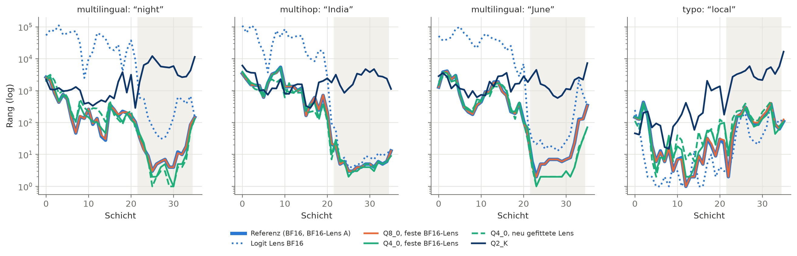

# jspace-quant-research

[English](README.md) · **Deutsch**

Anthropics Jacobian Lens liest aus den Zwischenschichten eines Sprachmodells Konzepte aus, die das
Modell „im Kopf“ hat, aber nicht ausspricht — den *Global Workspace*. Bleibt dieses Signal erhalten,
wenn man das Modell quantisiert, so wie es lokal fast immer läuft?

Untersucht an **Spark-X2.6-4B** in BF16 (Referenz), Q8_0 und Q4_0, erweitert um eine Bitbreiten-Leiter
bis 2 Bit und eine Komponenten-Ablation.

## Ergebnis

- **8 Bit** ändert nichts Messbares — weniger Abweichung als eine zweite, auf anderem Text gefittete Lens.
- **Bis 4 Bit** bleiben die verborgenen Zwischenkonzepte lesbar, obwohl sich die gesamte
  Readout-Verteilung schon ab 5 Bit deutlich und mit der Schichttiefe wachsend verschiebt. Eine neu
  gefittete Lens holt Verluste zurück: Der Raum ist verschoben, nicht zerstört.
- **3 Bit** kostet messbar Konzepte, **2 Bit** zerstört sie.
- Die Drift entsteht im Residual Stream; Attention, MLP und Embedding tragen jeweils bei.
- **Auch kausal:** Steering entlang der auf BF16 gefitteten Lens-Richtungen lenkt die Antwort des
  Modells um (27 % gegenüber 5 % in einer Kontrolle) und wirkt bis 4 Bit auf den quantisierten
  Modellen genauso; bei 3 Bit lässt es nach, bei 2 Bit ist es weg.



Details, Zahlen und Reflexion: [`docs/de/05-ergebnisse.md`](docs/de/05-ergebnisse.md). Walkthrough mit
Code und Abbildungen: [`notebooks/walkthrough.de.ipynb`](notebooks/walkthrough.de.ipynb).

## Vorgehen

1. **Lens fitten:** Für Spark gibt es keine fertige Lens. Wir fitten sie mit
   [jlens-gguf](https://github.com/igorbarshteyn/jlens-gguf) auf llama.cpp — pro Schicht eine
   Ridge-Regression in den Raum der letzten Schicht, über 1000 WikiText-Absätze (mit zwei Patches an
   jlens-gguf, siehe [`patches/`](patches/README.md)).
2. **Vergleichen:** Die BF16-Lens wird auf die quantisierten Modelle angewendet, dazu je eine neu
   gefittete Lens; eine zweite BF16-Lens auf anderem Korpus dient als Rauschgrenze.
3. **Messen:** ob die verborgenen Zwischenkonzepte der sechs Eval-Sets des Papers noch lesbar sind
   (pass@k), wie stark sich die Readouts pro Schicht verändern und wie sich das Modellverhalten ändert.
4. **Eingreifen:** den Residual Stream auf dem Paper-Set `probe-swap` entlang von Lens-Richtungen
   steuern und prüfen, ob die Antwort folgt — auf jeder Quantisierungsstufe.

## Dokumentation

Siehe die Tabelle im [englischen README](README.md#documentation); die deutschen Fassungen liegen in
[`docs/de/`](docs/de/): [`01-hintergrund`](docs/de/01-hintergrund.md),
[`02-methodik`](docs/de/02-methodik.md), [`03-setup`](docs/de/03-setup.md),
[`04-entscheidungen`](docs/de/04-entscheidungen.md), [`05-ergebnisse`](docs/de/05-ergebnisse.md).

## Code

Code, Kommentare und Kommandozeile sind englisch; Abbildungen gibt es in beiden Sprachen
(`results/figures/en/`, `results/figures/de/`).

```bash
.venv/bin/python -m jspace_quant capture   # Aktivierungen erfassen
.venv/bin/python -m jspace_quant analyze   # Metriken
.venv/bin/python -m jspace_quant plot      # Abbildungen
```

Vollständige Anleitung: [`docs/de/03-setup.md`](docs/de/03-setup.md).

## Lizenz

Code und Dokumentation: [Apache 2.0](LICENSE). Die Korpus-Auszüge in `data/corpus/` stammen aus
WikiText-103 und stehen unter CC BY-SA 4.0 (siehe [`data/corpus/README.md`](data/corpus/README.md)).
