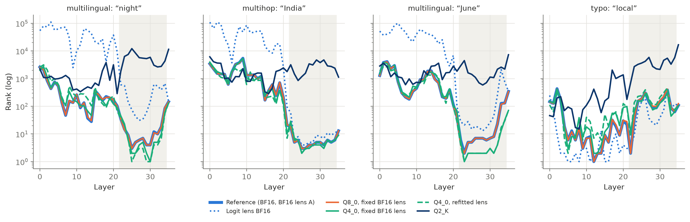

# jspace-quant-research

**English** · [Deutsch](README.de.md)

Anthropic's Jacobian lens reads concepts out of a language model's intermediate layers that the model
"has in mind" but does not say — the *global workspace*. Does this signal survive when the model is
quantized, the way it almost always runs locally?

We study **Spark-X2.6-4B** in BF16 (reference), Q8_0 and Q4_0, extended by a bit-width ladder down to
2 bit and a component ablation.

## Results

- **8 bit** changes nothing measurable — less deviation than a second lens fitted on different text.
- **Down to 4 bit** the hidden intermediate concepts stay readable, although the full readout
  distribution already shifts clearly from 5 bit on, growing with layer depth. A refitted lens recovers
  losses: the space is shifted, not destroyed.
- **3 bit** measurably costs concepts, **2 bit** destroys them.
- The drift arises in the residual stream; attention, MLP and embedding each contribute.



Details, numbers and reflection: [`docs/en/05-results.md`](docs/en/05-results.md). Walkthrough with
code and figures: [`notebooks/walkthrough.en.ipynb`](notebooks/walkthrough.en.ipynb).

## Approach

1. **Fit the lens:** there is no pre-fitted lens for Spark. We fit it with
   [jlens-gguf](https://github.com/igorbarshteyn/jlens-gguf) on llama.cpp — per layer a ridge
   regression into the space of the last layer, over 1000 WikiText paragraphs (with two patches to
   jlens-gguf, see [`patches/`](patches/README.md)).
2. **Compare:** the BF16 lens is applied to the quantized models, plus a refitted lens per quant; a
   second BF16 lens on a different corpus serves as the noise floor.
3. **Measure:** whether the hidden intermediate concepts of the paper's six eval sets are still readable
   (pass@k), how much the readouts change per layer, and how the model's behavior changes.

## Documentation

| | English | Deutsch |
|---|---|---|
| Background: paper, lens, tools, model, literature | [`01-background`](docs/en/01-background.md) | [`01-hintergrund`](docs/de/01-hintergrund.md) |
| Methodology: hypotheses, design, metrics, statistics | [`02-methodology`](docs/en/02-methodology.md) | [`02-methodik`](docs/de/02-methodik.md) |
| Setup: versions, patches, reproduction | [`03-setup`](docs/en/03-setup.md) | [`03-setup`](docs/de/03-setup.md) |
| Methodological decisions along the way | [`04-decisions`](docs/en/04-decisions.md) | [`04-entscheidungen`](docs/de/04-entscheidungen.md) |
| Results, hypotheses, reflection | [`05-results`](docs/en/05-results.md) | [`05-ergebnisse`](docs/de/05-ergebnisse.md) |

## Code

```
src/jspace_quant/   pipeline: capture (GPU) → analyze (CPU) → plot
tests/              unit tests
scripts/            corpus, quantization, layout check, lens fits, notebooks
data/corpus/        frozen WikiText corpora
results/            tables, figures (en/de), logs
```

```bash
.venv/bin/python -m jspace_quant capture   # capture activations
.venv/bin/python -m jspace_quant analyze   # metrics
.venv/bin/python -m jspace_quant plot      # figures
```

Full instructions: [`docs/en/03-setup.md`](docs/en/03-setup.md). Models, lenses and activations
(~60 GB) are not in the repository but can be reproduced with it.

## License

Code and documentation: [Apache 2.0](LICENSE). The corpus excerpts in `data/corpus/` are from
WikiText-103 and licensed under CC BY-SA 4.0 (see [`data/corpus/README.md`](data/corpus/README.md)).
